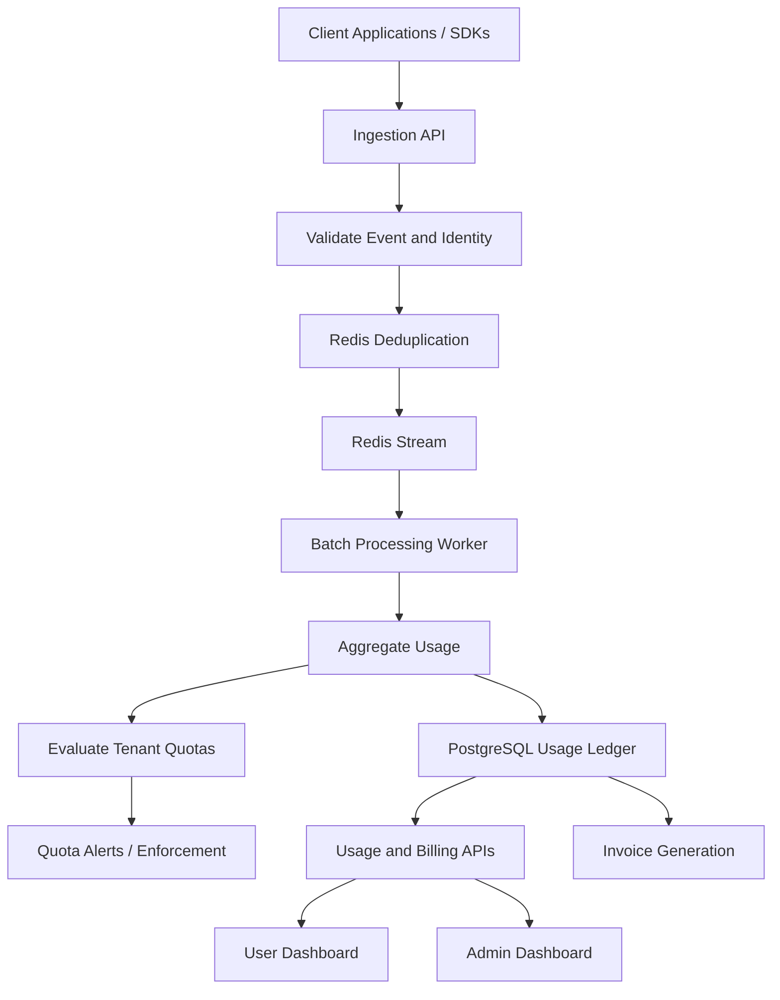

# Distributed Metering & Usage-Based Billing Platform

**A usage metering and billing platform for AI applications, SaaS products, and API-driven services.**

A software engineering project focused on tracking tenant-level consumption, processing usage events, preventing duplicate metering, monitoring quotas, calculating usage-based costs, and providing administrative controls for usage and pricing management.

---

## Table of Contents

- [Overview](#overview)
- [Problem Statement](#problem-statement)
- [Project Objectives](#project-objectives)
- [Key Features](#key-features)
- [System Architecture](#system-architecture)
- [Technology Stack](#technology-stack)
- [How the Platform Works](#how-the-platform-works)
- [User Roles](#user-roles)
- [Usage-Based Billing Model](#usage-based-billing-model)
- [API Documentation](#api-documentation)
- [Database Design](#database-design)
- [Installation and Setup](#installation-and-setup)
- [Environment Configuration](#environment-configuration)
- [Running the Application](#running-the-application)
- [Testing and Verification](#testing-and-verification)
- [Security Considerations](#security-considerations)
- [Deployment](#deployment)
- [Challenges and Engineering Considerations](#challenges-and-engineering-considerations)
- [Future Improvements](#future-improvements)
- [Learning Outcomes](#learning-outcomes)
- [Contributing](#contributing)
- [License](#license)

---

## Overview

The Distributed Metering & Usage-Based Billing Platform is designed to demonstrate how modern software systems can measure application consumption and translate that consumption into tenant-specific usage records, quota calculations, and billing information.

Applications that provide AI model access, API services, or other metered resources need a reliable mechanism to understand how much each customer consumes. Tracking usage becomes more challenging when requests arrive concurrently, clients retry failed requests, and multiple tenants share the same infrastructure.

This project addresses these challenges through a metering pipeline that accepts usage events, identifies duplicate events, processes consumption records, aggregates usage, evaluates quota limits, and supports usage-based cost reporting.

The platform is intended to serve as a foundation for understanding multi-tenant metering, asynchronous processing, idempotency, quota enforcement, billing calculations, and operational monitoring.

### Project Goals

- Track consumption across multiple tenants.
- Record usage events from application and API activity.
- Reduce duplicate usage accounting through idempotency controls.
- Aggregate usage over hourly and billing-period intervals.
- Monitor tenant-specific quotas and usage thresholds.
- Calculate estimated charges using configurable pricing rules.
- Provide dashboards and administrative tools for monitoring usage and managing configuration.
- Explore the integration of AI model consumption metrics into a centralized billing pipeline.

## Problem Statement

Traditional request logging is not sufficient for applications that charge customers according to their consumption.

A reliable usage-based billing system must answer several questions:

- Which tenant generated a usage event?
- What resource or metric was consumed?
- How many units were consumed?
- Has the same event already been processed?
- How much of the tenant's quota has been used?
- What is the estimated cost of the recorded consumption?
- What happens when a quota threshold is reached?
- How can usage and billing records be inspected and audited?

Without appropriate controls, repeated requests can inflate usage totals, concurrent updates can produce inconsistent calculations, and pricing configuration can become difficult to manage.

This project explores a centralized architecture for collecting, processing, aggregating, and reporting consumption data while keeping tenant-level usage and billing information organized.

## Project Objectives

1. **Reliable metering:** Capture usage events with tenant identifiers, metric names, units, timestamps, and unique event identifiers.
2. **Duplicate protection:** Prevent repeated event submissions from unnecessarily increasing recorded consumption.
3. **Asynchronous processing:** Separate request ingestion from downstream aggregation to improve responsiveness and absorb traffic bursts.
4. **Quota monitoring:** Track consumption against configurable tenant limits and warning thresholds.
5. **Usage-based pricing:** Calculate costs from recorded consumption and applicable pricing rules.
6. **Administrative management:** Support oversight of tenant usage, quota configuration, pricing policies, and usage records.
7. **AI integration:** Provide a design for collecting token consumption from supported AI model integrations.
8. **Operational visibility:** Make usage data, processing outcomes, and billing information available for inspection and testing.

## Key Features

### 1. Usage Event Ingestion

The metering pipeline accepts structured usage events containing information such as:

- Event ID
- Tenant ID
- Metric name
- Consumed units
- Event timestamp

Example event:

```json
{
  "eventId": "evt_10001",
  "tenantId": "tenant_demo",
  "metricName": "api_calls",
  "units": 10,
  "timestamp": "2026-10-13T10:00:00Z"
}
```

The ingestion layer validates the incoming payload and passes accepted events into the processing pipeline.

### 2. Idempotent Event Processing

Clients may retry requests because of network failures, timeouts, or uncertain responses. A metering platform must distinguish a retry from a genuinely new usage event.

The architecture uses two complementary controls:

- **Redis-based deduplication:** An atomic key operation can identify previously received event IDs within a configured retention period.
- **Database-level uniqueness:** Appropriate unique constraints and transactional event-processing records provide durable protection against duplicate accounting.

The intended result is that resubmitting an already processed event does not increase the tenant's billable usage a second time.

The exact guarantees depend on how deduplication, database transactions, and message acknowledgements are implemented.

### 3. Asynchronous Usage Processing

Usage ingestion is separated from aggregation using a stream-processing approach.

The intended workflow is:

1. Accept and validate an event.
2. Apply the deduplication check.
3. Publish the event to a Redis Stream.
4. Process queued events in batches.
5. Group consumption by tenant, metric, and time bucket.
6. Update persistent usage aggregates.
7. Acknowledge processed stream messages.

This design helps isolate the request-facing API from slower database operations and provides a foundation for handling traffic bursts.

### 4. Tenant Quota Management

Each tenant can have an associated quota configuration, including:

- Plan or tier
- Monthly unit limit
- Warning threshold
- Unit pricing
- Hard-cap setting
- Billing-cycle configuration

The platform can evaluate consumption against configured limits and identify tenants approaching or exceeding their quotas.

### 5. Usage Analytics and Dashboard

The dashboard is intended to help users understand their consumption and estimated expenditure through metrics such as:

- Total units consumed
- Usage by metric
- Usage over time
- Quota utilization
- Estimated billing amount
- Usage trends and historical aggregates

The values displayed should be calculated from backend usage and pricing data rather than hardcoded presentation values.

### 6. Administrative Dashboard

The administrative experience provides operational visibility and configuration capabilities.

Depending on the implemented permissions and backend endpoints, these capabilities include:

- Reviewing tenant usage
- Inspecting processed usage events
- Managing quota settings
- Configuring pricing and plan rules
- Monitoring quota thresholds
- Performing authorized quota resets
- Reviewing usage and billing information

Administrative operations should be protected by server-side authorization.

### 7. AI Usage Metering

AI applications can consume resources measured in tokens, requests, or other provider-specific units.

The uploaded AI middleware design describes capturing token usage from model responses and publishing usage events to the metering pipeline.

For example, an AI response reporting 18 prompt tokens and 42 completion tokens can produce a usage event containing 60 total tokens.

The integration can be extended to record additional dimensions such as provider, model, prompt tokens, completion tokens, and request identifiers.

Actual token counts should come from the provider's response usage metadata whenever available, rather than being estimated from the prompt length.

### 8. Usage and Billing Records

The platform's data model supports hourly usage aggregates and invoice records.

These records provide a basis for:

- Historical usage reporting
- Period-based consumption summaries
- Cost calculations
- Billing statement generation
- Invoice status tracking
- Audit and reconciliation workflows

Payment collection and invoice settlement are separate concerns from usage metering and should be integrated explicitly if required.

---

## System Architecture

The project blueprint describes a three-layer metering architecture.

### High-Level Flow



### Layer 1: Ingestion

The ingestion layer accepts events from client applications, SDKs, or API gateways.

Its responsibilities include:

- Request validation
- Authentication and tenant identification
- Event deduplication
- Stream publication
- Returning an appropriate response to the client

The blueprint uses an HTTP endpoint under `/api/v1/meter/events` and describes Redis as the fast-path deduplication and buffering mechanism.

### Layer 2: Stream Processing

The worker processes queued events asynchronously.

The blueprint describes a micro-batch workflow that:

1. Reads records from a Redis Stream consumer group.
2. Groups usage by tenant, metric, and hour.
3. Evaluates quota consumption.
4. Writes usage aggregates to PostgreSQL using atomic upserts.
5. Acknowledges successfully processed stream records.

The worker should also account for retries, pending messages, processing failures, and recovery after crashes.

### Layer 3: Persistence and Analytics

PostgreSQL stores persistent usage aggregates, tenant quota configurations, and invoice records.

The database acts as the durable source for historical usage and billing calculations.

Redis supports low-latency event handling and stream processing, while PostgreSQL provides durable records for reporting and reconciliation.

**Important engineering consideration:** Redis deduplication alone does not provide complete exactly-once financial processing. Durable uniqueness, transactional accounting, and safe message-recovery logic are required to prevent both duplicate charges and lost usage during failures.

---

## Technology Stack

The following technologies are described in the supplied architecture blueprint. Verify the actual repository dependencies before publishing this section as the definitive stack for your deployed application.

| Component | Technology | Purpose |
|---|---|---|
| Backend | Java 21, Spring Boot 3.3 | API and processing services |
| Data access | Spring Data JPA, JDBC | Persistence and database operations |
| Concurrency | Java Virtual Threads / reactive processing | Request and workload handling |
| Stream processing | Redis 7 Streams | Asynchronous event buffering |
| Deduplication | Redis atomic operations | Fast duplicate detection |
| Database | PostgreSQL 16 | Persistent usage and billing records |
| Database migrations | Flyway | Schema version management |
| Frontend | React 18 | Dashboard and application UI |
| Visualization | Recharts | Usage analytics and charts |
| Testing | JUnit 5, Testcontainers | Automated and integration testing |
| Load testing | k6 | Throughput and latency testing |
| Infrastructure | Docker Compose | Local dependency orchestration |
| Deployment | Render or another compatible host | Application hosting |

If your current repository uses a different backend framework or database configuration, update the table to reflect the implementation rather than the reference architecture.

## How the Platform Works

### Step 1: A Client Generates Usage

A client application performs a metered action, such as an API request or AI model completion.

The application generates a unique event identifier and reports the associated consumption.

### Step 2: The Ingestion API Accepts the Event

The backend validates the event payload and determines which tenant it belongs to.

Invalid or unauthorized requests should be rejected before they affect usage or billing.

### Step 3: Duplicate Events Are Identified

The ingestion service checks whether the event has already been accepted or accounted for.

A repeated event can be acknowledged as a duplicate without creating additional billable consumption.

### Step 4: The Event Enters the Processing Pipeline

Accepted events are published to the stream, allowing the API to return promptly without waiting for the entire aggregation workflow.

### Step 5: Usage Is Aggregated

The processing worker groups events by tenant, metric, and time interval, then updates persistent usage totals.

### Step 6: Quotas and Costs Are Evaluated

The system compares consumption with the tenant's quota configuration and calculates estimated costs according to the applicable pricing rules.

Warning thresholds and hard caps can trigger alerts or enforcement actions when those behaviors are implemented.

### Step 7: Usage Becomes Available for Reporting

The dashboard and reporting endpoints retrieve persisted usage data and present it as consumption totals, trends, quota progress, and estimated charges.

### Step 8: Billing Records Are Prepared

Usage for the relevant billing period can be summarized into an invoice or billing ledger entry.

Finalized invoices should retain enough information about the billing period, consumed units, applied pricing, and adjustments to support reconciliation.

---

## User Roles

The platform separates customer-facing functionality from administrative operations.

### Regular User / Tenant

The tenant-facing experience is intended for customers who need to monitor their own usage.

Typical capabilities include:

- Viewing usage dashboards
- Inspecting consumption history
- Monitoring quota utilization
- Viewing estimated costs
- Reviewing available billing records
- Testing supported application or AI integrations

A tenant should only be able to access data belonging to that tenant.

### Administrator / Super Administrator

The administrative experience is intended for platform operators.

Depending on the authorization model, capabilities may include:

- Reviewing usage across tenants
- Configuring quotas and thresholds
- Managing pricing policies and plans
- Inspecting usage events
- Monitoring billing records
- Performing authorized quota resets
- Managing platform-level configuration

Administrative permissions should be distinct from ordinary tenant permissions. Hiding a control in the frontend is not sufficient authorization.

---

## Usage-Based Billing Model

The platform calculates usage-based charges using consumed units and the applicable unit rate.

A basic pricing formula is:

```text
Usage Cost = Billable Units × Unit Rate
```

For example, if a tenant consumes 10,000 billable units at a rate of $0.002 per unit:

```text
Usage Cost = 10,000 × $0.002
           = $20.00
```

For a pricing model that includes a base subscription fee:

```text
Subtotal = Base Fee + Usage Charges
```

If taxes apply:

```text
Total Amount = Subtotal + Applicable Taxes
```

These formulas are illustrative. The actual billing calculation depends on the configured plan, billing rules, taxes, credits, and rounding policy.

### Quota Utilization

Quota usage can be calculated as:

```text
Quota Utilization (%) =
    (Consumed Units / Monthly Unit Limit) × 100
```

For example, consuming 7,500 units out of a 10,000-unit quota results in 75% utilization.

The blueprint describes a configurable warning threshold, with 80% as the example threshold and 100% as the example hard-cap boundary.

### Pricing Considerations

A production-oriented billing implementation should define:

- Included usage allowances
- Per-unit pricing
- Tiered or graduated pricing
- Overage charges
- Free-tier restrictions
- Quota reset rules
- Billing-period boundaries
- Decimal precision and rounding
- Tax handling
- Invoice finalization
- Adjustments and refunds

A usage dashboard may display estimated costs before invoice finalization. Estimated usage costs should be clearly distinguished from finalized charges and successfully settled payments.

---

## API Documentation

The supplied architecture defines the event ingestion endpoint below.

### Ingest Usage Event

`POST /api/v1/meter/events`

Accepts a usage event for processing.

Example request:

```bash
curl -X POST http://localhost:8080/api/v1/meter/events \
  -H "Content-Type: application/json" \
  -d '{
    "eventId": "evt_10001",
    "tenantId": "tenant_demo",
    "metricName": "api_calls",
    "units": 10,
    "timestamp": "2026-10-13T10:00:00Z"
  }'
```

Example accepted response:

```json
{
  "status": "QUEUED",
  "eventId": "evt_10001"
}
```

The reference implementation returns HTTP `202 Accepted` for queued events.

A duplicate event may produce a response such as:

```json
{
  "status": "DUPLICATE_IGNORED",
  "eventId": "evt_10001"
}
```

The exact response format and status codes should match the current implementation.

### Additional API Areas

The architecture and UI blueprint describe the following functional API areas. Their exact paths and HTTP methods must be documented from the actual backend implementation.

| API area | Purpose |
|---|---|
| Usage reporting | Retrieve tenant consumption and historical aggregates |
| Quota management | Retrieve and configure tenant limits |
| Pricing management | Manage plans, rates, and thresholds |
| Event inspection | Inspect usage records and processing outcomes |
| Invoice management | Retrieve invoice and billing-period records |
| AI integration | Generate AI responses and capture model usage |
| Administration | Perform authorized platform management operations |

Do not assume that all these routes are implemented merely because the corresponding UI or architecture is described.

For the current API contract, use the backend's route definitions, request DTOs, response DTOs, and authorization configuration as the source of truth.

---

## Database Design

The reference blueprint describes three primary data structures.

### 1. `usage_hourly_aggregates`

Stores aggregated usage for a tenant and metric within an hourly bucket.

| Column | Purpose |
|---|---|
| `tenant_id` | Tenant associated with the usage |
| `metric_name` | Metered resource or activity |
| `bucket_hour` | Start of the hourly time bucket |
| `total_units` | Aggregated consumption |
| `total_cost` | Aggregated monetary amount |
| `last_updated_at` | Most recent update timestamp |

The reference schema uses a composite primary key over `tenant_id`, `metric_name`, and `bucket_hour`.

This structure supports historical reporting and atomic updates to hourly usage totals.

### 2. `tenant_quota_configs`

Stores tenant-specific quota and pricing configuration.

The reference schema includes:

- Tenant ID
- Tier name
- Monthly unit limit
- Hard-cap setting
- Alert threshold percentage
- Unit rate
- Creation timestamp

These settings determine how consumption is evaluated and priced.

### 3. `tenant_invoices`

Stores finalized billing-period records.

The reference schema includes:

- Invoice ID
- Tenant ID
- Billing-period start and end dates
- Total units consumed
- Total billed amount
- Payment status
- Creation timestamp

A production implementation should additionally enforce appropriate uniqueness for tenant billing periods, maintain invoice-line details where required, and preserve finalized billing information for auditability.

### Database Integrity

Recommended integrity controls include:

- Unique constraints for event identifiers within their intended scope
- Transactional updates to usage and billing records
- Atomic upserts for aggregates
- Consistent monetary precision
- Validated foreign keys where appropriate
- Safe handling of concurrent requests
- Versioned schema migrations
- A reconciliation mechanism for detecting mismatches between events and aggregates

---

## Installation and Setup

The exact commands depend on the repository structure. The following workflow assumes the reference Spring Boot architecture and a local environment with Java, Maven or Gradle, PostgreSQL, and Redis.

### Prerequisites

Install the tools required by your implementation:

- Git
- Java 21
- Maven or Gradle
- Node.js and npm, if the React frontend is present
- Docker and Docker Compose
- PostgreSQL
- Redis

If Docker Compose already provisions PostgreSQL and Redis, separate local installations of those services may not be necessary.

### 1. Clone the Repository

Replace the placeholder URL with your actual GitHub repository URL.

```bash
git clone <YOUR_GITHUB_REPOSITORY_URL>
cd <YOUR_PROJECT_DIRECTORY>
```

### 2. Start Infrastructure Services

If your repository contains a Docker Compose configuration for the required services:

```bash
docker compose up -d
```

Check that the containers are running:

```bash
docker compose ps
```

Confirm the configured PostgreSQL and Redis connection settings before starting the application.

### 3. Configure the Backend

Navigate to the backend directory identified in your repository.

Configure the database URL, database credentials, Redis connection, and any required application secrets using environment variables or your existing configuration mechanism.

For a Maven-based Spring Boot project, a typical command is:

```bash
./mvnw spring-boot:run
```

On Windows:

```powershell
.\mvnw.cmd spring-boot:run
```

If your project uses Gradle, a different backend framework, or a different startup command, use the corresponding repository instructions.

### 4. Install Frontend Dependencies

If the repository contains a React frontend:

```bash
cd frontend
npm install
```

Start the development server using the script defined in `package.json`:

```bash
npm run dev
```

Some React projects use `npm start` instead. Check the available scripts before running the command.

### 5. Verify the Application

After starting the services:

1. Confirm that the backend starts without configuration errors.
2. Confirm that the database connection succeeds.
3. Confirm that Redis is reachable.
4. Check that database migrations have completed.
5. Open the frontend using the local URL printed by its development server.
6. Submit a test usage event to the ingestion endpoint.
7. Verify that usage appears in the persistent records and relevant dashboard.

---

## Environment Configuration

Use environment variables for sensitive configuration instead of committing credentials to the repository.

Example variable names:

```dotenv
# Application
SERVER_PORT=8080

# PostgreSQL
DB_URL=jdbc:postgresql://localhost:5432/metering_db
DB_USERNAME=your_local_database_user
DB_PASSWORD=your_local_database_password

# Redis
REDIS_HOST=localhost
REDIS_PORT=6379

# Frontend
VITE_API_BASE_URL=http://localhost:8080
```

These are illustrative variable names, not a guarantee that the current application reads them. Match them to the configuration used in the repository.

### AI Provider Configuration

If AI model integration is enabled, configure supported provider credentials separately using the variable names expected by the application.

For example, a project may use variables such as:

```dotenv
GEMINI_API_KEY=your_gemini_api_key
OPENAI_API_KEY=your_openai_api_key
ANTHROPIC_API_KEY=your_anthropic_api_key
GROQ_API_KEY=your_groq_api_key
MISTRAL_API_KEY=your_mistral_api_key
```

Only configure the providers that the current implementation supports.

**Never commit actual API keys, database passwords, access tokens, or production secrets.** Keep `.env` files out of version control and provide a sanitized `.env.example` containing variable names and placeholder values.

---

## Testing and Verification

Testing is particularly important for metering and billing because incorrect usage totals can lead to incorrect charges.

### 1. Idempotency Testing

Submit the same event multiple times using the same tenant ID and event ID.

Verify that:

- The duplicate is identified.
- Only one logical usage event is accounted for.
- The final usage total matches the expected value.

For example, submitting an event containing 100 units 25 times should result in 100 units of accounted consumption if all submissions represent the same logical event and deduplication is functioning correctly.

### 2. Concurrent Ingestion Testing

Submit many distinct usage events concurrently.

Verify that:

- Valid events are accepted.
- No distinct event is silently lost.
- Aggregated usage matches the sum of accepted logical events.
- Concurrent database updates do not overwrite each other.

### 3. Quota Testing

Test usage values below, at, and above the configured threshold.

Verify that the system calculates quota utilization correctly and applies the configured warning or hard-cap policy.

### 4. Pricing Testing

Test representative pricing cases, including:

- Zero consumption
- Included usage
- Standard per-unit charges
- Tier transitions
- Overage charges
- Decimal precision and rounding
- Billing-period boundaries

Compare the calculated amounts against independently computed expected results.

### 5. Worker Failure and Recovery Testing

Simulate processing failures and worker restarts.

Verify that pending stream messages can be recovered, successfully committed work is not billed twice, and messages are acknowledged only when the required processing has completed.

### 6. Load Testing

The reference blueprint includes a k6 scenario that increases traffic from 50 to 150 virtual users.

A load test can help measure:

- Request throughput
- Response latency
- Error rate
- Stream backlog
- Worker processing rate
- Database write pressure
- Memory usage under load

A sample command, if the repository contains a compatible script, is:

```bash
k6 run tests/load/usage-ingestion.js
```

Update the script path to match the actual repository.

The blueprint mentions a p99 response-latency target of 15 milliseconds and an HTTP failure-rate target below 0.1%. These are proposed test thresholds, not verified performance results or guarantees.

### Testing Tools

- JUnit 5 for backend unit tests
- Testcontainers for integration testing against real service dependencies
- Playwright for end-to-end frontend testing, if included
- k6 for load testing
- API clients or automated HTTP tests for endpoint validation

### Verification Checklist

- [ ] Valid usage events are accepted.
- [ ] Invalid events are rejected.
- [ ] Duplicate events do not inflate usage.
- [ ] Distinct concurrent events are accounted for correctly.
- [ ] Usage aggregates match accepted events.
- [ ] Quota calculations match configured limits.
- [ ] Pricing calculations match expected amounts.
- [ ] Worker failures can be recovered safely.
- [ ] Tenant data is isolated.
- [ ] Administrative operations require appropriate authorization.
- [ ] Frontend values match backend records.
- [ ] Database migrations work on a clean environment.

---

## Security Considerations

Security is essential because the platform handles tenant identities, API usage, pricing configuration, and potentially financial records.

### Authentication and Authorization

- Authenticate requests before accepting billable usage.
- Resolve tenant identity through trusted credentials rather than trusting arbitrary client-supplied tenant IDs.
- Enforce tenant-level access controls on backend endpoints.
- Restrict administrative operations using server-side role checks.
- Protect sensitive operations such as quota resets and pricing changes.

### API Key Management

- Store API keys securely.
- Avoid logging complete credentials.
- Support revocation and rotation where applicable.
- Associate credentials with the correct tenant.
- Avoid exposing provider credentials to browser code.

### Usage Integrity

- Validate metric names, units, timestamps, and event identifiers.
- Prevent clients from changing trusted pricing rules.
- Use database transactions and appropriate uniqueness constraints.
- Ensure retry and recovery mechanisms cannot double-count usage.
- Record administrative adjustments and other billing-relevant changes.

### Operational Security

- Use HTTPS in deployed environments.
- Keep secrets out of source control.
- Apply appropriate database and Redis access controls.
- Restrict production service access.
- Monitor abnormal ingestion rates and repeated failures.
- Retain logs and audit records according to operational requirements.

---

## Deployment

The application can be deployed to a compatible hosting platform, provided that the backend, frontend, database, and Redis configuration are supported.

A deployment architecture may consist of:

- A frontend service for the dashboard
- A backend service for APIs and application logic
- A managed PostgreSQL database
- A Redis instance or managed Redis-compatible service
- Secure environment-variable configuration

### Deployment Checklist

1. Verify that the application starts correctly in a clean local environment.
2. Confirm production database and Redis connectivity.
3. Apply database migrations safely.
4. Configure environment variables and secrets.
5. Verify frontend-to-backend API connectivity.
6. Configure CORS and authentication correctly.
7. Confirm health checks and service logs.
8. Test ingestion and duplicate handling after deployment.
9. Validate quota calculations and pricing against known test cases.
10. Verify worker recovery and data persistence.

Deployment configuration should be adapted to the actual hosting platform and repository. A successful deployment does not by itself prove that metering, billing, or failure recovery is correct.

---

## Challenges and Engineering Considerations

### Duplicate Requests and Billing Accuracy

Client retries can create repeated events. The platform needs a stable event identity and durable duplicate protection so retries do not inflate usage totals.

### High-Frequency Ingestion

Writing every usage event directly to the database can create excessive database traffic. Asynchronous streams and batch processing can reduce write overhead and improve the handling of traffic bursts.

### Concurrent Aggregation

Multiple workers may process different events belonging to the same tenant and metric. Atomic database updates and carefully designed transaction boundaries are necessary to maintain accurate totals.

### Failure Recovery

A worker can fail between reading an event, updating the database, and acknowledging the message. Recovery logic must handle this situation without losing usage or counting it twice.

### Tenant Isolation

Shared infrastructure must preserve logical isolation between tenants. Every usage lookup, quota update, and billing operation needs appropriate tenant scoping and authorization.

### Pricing and Financial Consistency

Pricing changes, quota resets, rounding, and billing-period boundaries can affect calculated amounts. Reproducible billing requires explicit rules and sufficient historical information to explain how each charge was calculated.

### Monitoring and Observability

A production-oriented implementation benefits from metrics for ingestion latency, processing throughput, stream backlog, retry counts, database errors, quota events, and billing discrepancies.

---

## Future Improvements

Potential improvements to explore include:

- **Multi-provider AI metering:** Standardize usage collection across Gemini, OpenAI, Anthropic, Groq, Mistral, and other supported providers.
- **Tenant-specific SDKs:** Provide reusable client libraries for reporting usage events.
- **Durable idempotency ledger:** Persist event-processing state and accounting decisions for stronger recovery guarantees.
- **Advanced pricing engine:** Support graduated pricing, volume discounts, credits, and more complex billing policies.
- **Real-time usage updates:** Stream dashboard updates using Server-Sent Events or WebSockets.
- **Automated quota notifications:** Send configurable alerts when consumption approaches defined thresholds.
- **Invoice exports:** Generate downloadable billing statements and detailed invoice line items.
- **Payment integration:** Integrate a suitable payment provider if actual payment collection is required.
- **Usage reconciliation:** Compare raw events, aggregates, and finalized invoices to detect discrepancies.
- **Distributed worker scaling:** Scale processing workers while preserving safe message handling and accounting consistency.
- **Observability:** Add centralized logs, metrics, tracing, and operational dashboards.
- **Enhanced security:** Introduce credential rotation, audit trails, rate limiting, and more granular authorization.
- **Expanded automated testing:** Add failure-injection, concurrency, billing-regression, and end-to-end tests.

These items are potential extensions and should not be interpreted as existing features unless they have been implemented and verified.

---

## Learning Outcomes

This project provides an opportunity to explore several important software engineering concepts:

- Distributed event-processing architecture
- Usage-based monetization
- Multi-tenant data modeling
- Idempotent request handling
- Redis Streams and consumer groups
- Asynchronous batch processing
- PostgreSQL upserts and transactional integrity
- Quota management and threshold evaluation
- Usage aggregation and pricing calculations
- API design and integration
- Dashboard and administrative UI development
- Automated testing and load testing
- Deployment and configuration management
- Security considerations for billing-related systems

---

## Contributing

Contributions and suggestions are welcome.

A typical contribution workflow is:

1. Fork the repository.
2. Create a feature branch.
3. Implement the change.
4. Add or update tests.
5. Run the relevant test suite.
6. Commit your changes with a descriptive message.
7. Open a pull request explaining the change and its impact.

For changes affecting metering or billing, include tests that verify usage accuracy, duplicate handling, and expected pricing behavior.

---

## License

Choose an appropriate open-source license before publishing the repository.

If you intend to allow others to use, modify, and redistribute the project, consider adding a `LICENSE` file containing the full text of the selected license. Do not claim a license has been applied until the file is present.

---

## Project Status

This repository documents a distributed metering and usage-based billing project, including its ingestion architecture, tenant usage model, quota-management concepts, AI usage integration design, and billing workflow.

The supplied architecture blueprint describes a Redis Streams and PostgreSQL processing pipeline. Actual implementation status, supported API routes, deployment readiness, and performance characteristics should be verified against the current source code and test results.

**The primary engineering objective is reliable usage accounting:** accepted events should be traceable, repeated events should not inflate consumption, and billing calculations should be explainable and reproducible.

---

**Built as a software engineering project exploring distributed systems, API metering, tenant quotas, AI usage tracking, and usage-based billing.**
